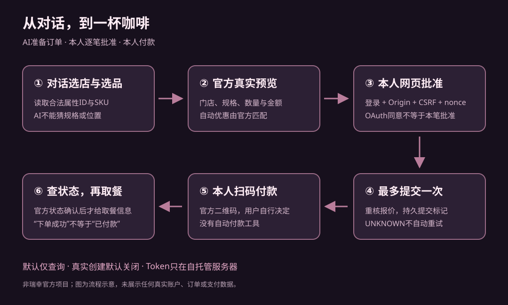

# 小葵 × 瑞幸 MCP

**简体中文** | [English](README.en.md)

> **零基础用户从这里开始：[完整中文新手部署教程](docs/beginners-guide.md)**。没有 KuiNest 也可以独立部署；从账号资格、服务器与域名开始，一步一步到真实查询和报价。卡住时看[常见问题](docs/faq.md)。

## 复制给 ChatGPT 的部署提示词

```text
我想部署 https://github.com/AriaEternity/xiaokui-luckin-mcp ，没有后端经验。
请先实际阅读本仓库最新 README、docs/beginners-guide.md、docs/deployment.md、docs/chatgpt.md、docs/faq.md、SECURITY.md，以及 package.json、src/config.ts 和部署模板。不能读取时明确告诉我，不要猜配置。
先询问我：电脑还是手机、ChatGPT是否能添加自定义MCP、有无本人合法瑞幸MCP Token资格、有无服务器/域名、服务器系统架构，以及费用预算。先确认资格再建议付费。
推荐仓库已有支持的Ubuntu24.04 x64 + Node24.20.0 + systemd/nginx方案；不要发明一键部署。一次只指导一个步骤，说明在哪里操作、输入什么、成功看到什么；等我回复结果再继续。错误先分层排查，不要关闭安全机制。
密码、Token、Cookie、验证码、私钥、owner.json和数据库只由我在自己的环境处理，不能要求粘贴给你。系统账号、本站owner账号、官方账户和ChatGPT账号要区分。两套MCP同机时核对端口和独立目录。
目标先完成离线验证、HTTPS、主人初始化、OAuth只读连接、真实商品查询，再开preview读取实际报价。保持ENABLE_ORDERS和ENABLE_ORDER_CREATE关闭，不自动调用真实创建、取消或支付；逐笔批准、UNKNOWN防重和本人付款不能跳过。明确区分原实践首单、公开版合成验证与我这次的真实验收。
现在只问准备条件，并给我第一个需要完成的小步骤。
```

**让你平时聊天的 AI，陪你把一杯咖啡从对话带到现实。**

把瑞幸官方 MCP 接入 ChatGPT：选店、选品、选规格、看真实报价，由本人逐笔批准后创建订单，返回官方二维码，用户自行付款，再查询订单和取餐信息。

这是一个**非瑞幸官方、单用户、自托管**的开源桥接服务。它源于 KuiNest 的一次真实实践：2026-10-17，ChatGPT 中的小葵完成了首笔订单，用户自行付款、实际取到咖啡，反馈“我喝到了”。本仓库是从该私人系统抽取并独立适配的版本；**原系统的真实首单与本仓库的合成验收是两类证据**，不能据此承诺所有商品、优惠或多用户场景均可靠。



## 能力和边界

| 入口 | Scope | Client ID | 工具数 | 默认 |
|---|---|---|---:|---|
| `/api/luckin/mcp` | `luckin:catalog:read` | `xiaokui-chatgpt-luckin` | 3 | 开启，仍需 OAuth |
| `/api/luckin/preview/mcp` | `luckin:checkout:preview` | `xiaokui-chatgpt-luckin-preview` | 5 | 关闭 |
| `/api/luckin/orders/mcp` | `luckin:orders:create` | `xiaokui-chatgpt-luckin-orders` | 7 | 关闭，创建另有总开关 |

七个工具：`queryShopList`、`searchProductForMcp`、`queryProductDetailInfo`、`switchProduct`、`previewOrder`、`createOrder`、`queryOrderDetailInfo`。catalog/preview 权限不能创建订单。取消、支付、任意工具透传均不开放，拒绝请求不会发送上游。

- OAuth + PKCE S256、精确 resource/scope/client 隔离、旋转 refresh token、令牌只存摘要。
- 上游凭据只从服务器私有文件/systemd credential 读取，不交给模型。
- 创建前必须本人 Cookie + Origin + CSRF + 私有 nonce 批准，OAuth 同意和聊天里的“确认”都不能代替。
- 服务器绑定门店、商品、规格、数量、优惠和金额；提交前重核报价。
- fsync 后才发送创建；SUBMITTING/UNKNOWN、崩溃遗留锁不自动重试。
- 支付必须由用户自行完成；状态 20“下单成功”不当成付款完成。
- 官方 HTTPS 二维码域名校验、字符串订单号、响应凭据递归脱敏及失败关闭。

## 运行前需要

1. Node.js **24.20.0**、npm **11.19.0**；已验证环境为 Ubuntu 24.04 / Linux x64。使用 Node 内置 SQLite，无 better-sqlite3/sharp 原生安装步骤。
2. 你自己的 HTTPS 域名和服务器，以及合法取得的瑞幸官方 MCP 凭据。Token 获取与使用权限以[瑞幸 AI 开放平台](https://open.lkcoffee.com/mcp)为准，本项目不提供账号或共享 Token。
3. 能添加自定义 MCP 的 ChatGPT 账号/工作区。具体权限以你当前界面和管理员策略为准。

**本仓库尚不提供免部署公共服务、多用户账户隔离或手机上一键安装。** 一个实例只绑定一个主人和一份瑞幸账户凭据；不要把它作为开放的代下单平台。

## 安装与本机合成演示

```sh
git clone https://github.com/AriaEternity/xiaokui-luckin-mcp.git
cd xiaokui-luckin-mcp
npm ci --ignore-scripts
npm run verify
umask 077
npm run owner:init
```

`owner:init` 在本机交互终端隐藏输入长口令，默认用户名 `owner`；仅把 salt、口令哈希和随机主人标识写入 `data/owner.json`，不接收命令行口令、不覆盖已有文件。

无需真实 Token 即可启动假上游：

```sh
PUBLIC_ORIGIN=https://coffee.example.com \
SYNTHETIC_UPSTREAM=true \
ENABLE_PREVIEW=true \
ENABLE_ORDERS=true \
npm start
curl --fail http://127.0.0.1:4318/health/ready
```

演示只返回合成店铺和商品，不联网、不创建真实订单、不提供可付款二维码。真实创建总开关仍为 false。浏览器登录/授权/确认使用 Secure Cookie，需要先按部署指南接入自己控制的 HTTPS 域名；上面的回环健康检查不是完整 ChatGPT 接入。

## 接入 ChatGPT 和真实账户

按[部署指南](docs/deployment.md)配置私有凭据、systemd 和 nginx，再按[ChatGPT 连接指南](docs/chatgpt.md)添加独立 orders OAuth 连接。先启用查询/预览验收，最后由部署者明确设置 `ENABLE_ORDER_CREATE=true`。开启该开关仍不能跳过逐笔确认。

完整流程：

1. 指定门店或明确允许的位置，读取商品和合法规格。属性/SKU 从当次官方详情获取，选中 operation 只允许已确认的 `3`。
2. 预览真实报价，展示门店、完整规格、数量、优惠和人民币应付金额；允许官方自动匹配优惠券。
3. 本人打开预览返回的确认链接，登录本服务账户并核对本笔。报价五分钟有效，批准后两分钟内提交。
4. 回 ChatGPT 让 AI 调用 `createOrder({intentId})`。服务端重核；发生变价或规格/券变化必须重新预览批准。
5. 用户自行使用官方 `payOrderQrCodeUrl` 付款，再用 `queryOrderDetailInfo({intentId})` 查询官方状态和取餐信息。

**创建结果 UNKNOWN/超时后，先在官方账户核实；禁止自动重建同一订单或反复换 intent 绕过未知状态。** 官方未提供本项目可用的创建幂等键或原子报价锁，不能保证网络异常时知道请求是否已成功。详见[安全模型](SECURITY.md)和[恢复方案](docs/deployment.md#回退与恢复)。

## 文档与验证

- [真实案例与完整复盘](docs/retrospective.md)：从只读工具到本人付款取餐，哪些经历值得复用。
- [架构与抽取差异](docs/architecture.md)：哪些核心复用、哪些适配层新写。
- [官方契约与来源](docs/contracts.md)：参数、副作用、金额与状态的证据边界。
- [ChatGPT OAuth 连接](docs/chatgpt.md)、[部署与回退](docs/deployment.md)。
- [公开范围和脱敏说明](docs/privacy.md)、[来源清单](docs/source-provenance.json)、[第三方声明](THIRD_PARTY_NOTICES.md)。

自动测试只使用合成数据和本机回环；假上游通过依赖注入提供，测试保护层拒绝真实外网 fetch。CI 不需要任何瑞幸 Token、个人账户、域名或生产服务器。最新测试结果见[验证记录](docs/validation.md)。

## 致谢与许可

感谢瑞幸官方 MCP 与公开文档，以及社区先行案例 [luckin-coffee](https://github.com/LiuZiqi-dual/luckin-coffee)、[chatgpt-mcp-connect 的麦当劳桥接方案](https://github.com/yoruuuchan/chatgpt-mcp-connect/tree/main/recipes/mcdonalds)和 [luckin-mcp-proxy](https://github.com/wyhAcc/luckin-mcp-proxy)。它们用于思路参考，本仓库未复制这些项目代码，也不再分发官方 my-coffee Skill、商标或私人图片。

自己的桥接代码采用 [MIT](LICENSE)。第三方依赖保持各自许可证；本许可证不授予瑞幸接口、账户、商标或对外运营权限。
