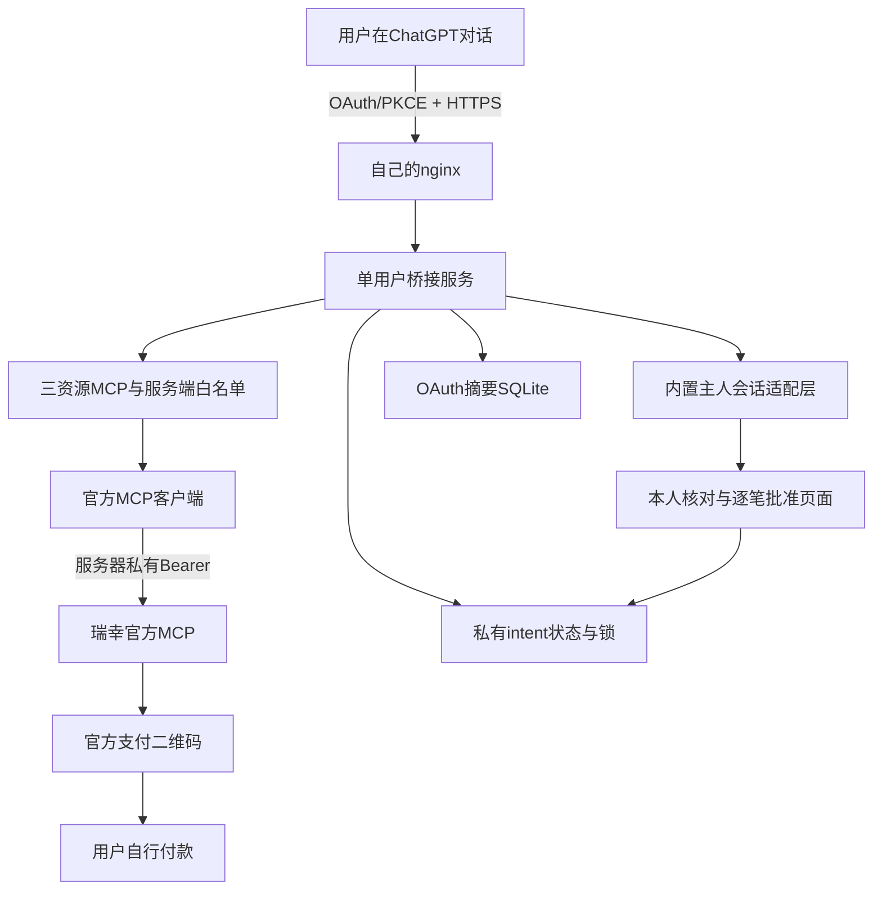

# 架构、抽取范围与适配差异

## 复用的核心

`src/contracts/`保留三/五/七工具合同；`src/mcp/`保留SDK协议、参数白名单、固定上游、超时/取消、递归脱敏；`src/luckin/`保留权威报价、逐笔批准、持久状态、fsync/锁、UNKNOWN与订单查询；`src/http/routes/`保留JSON/SSE及确认保护。

本仓库来自维护者自有KuiNest v4的17个明确文件，不从私人项目初始化Git，也不复制完整发布包。来源文件及导出哈希见source-provenance.json。原复盘有一处示意路径把订单编排写在mcp子目录，实际源码为`luckin/orders.ts`；本仓库以实际文件为准。

## 独立版做的适配

| 私人系统 | 公开独立版 |
|---|---|
| 借用原聊天网站登录 | `OwnerIdentity`接口与单主人内置登录，`/auth/*` |
| OAuth兼容路径带旧业务名 | 通用`/oauth/*`；元数据、页面、测试同步调整 |
| 还承载手机感知资源 | 只保留瑞幸三资源，无手机采集、聊天、人格或记忆代码 |
| 私有工作区contracts包 | 本仓库`src/contracts/`相对导入 |
| better-sqlite3及共享装配 | Node24内置SQLite薄适配，无原生安装脚本 |
| 私有域名/owner绑定 | 可配置HTTPS origin，owner:init生成随机标识 |
| 私有systemd部署文件 | 示例unit/nginx，全部使用example域名/独立目录 |
| 原固定客户端ID前缀 | `xiaokui-chatgpt-luckin*`；原生产ID未改变 |

SQLite仍只存本服务OAuth摘要；没有读取、复制或转换原生产OAuth库。独立版不承诺直接打开私人系统的所有库；升级自己的公开版时应保留状态目录，并按部署指南演练。

独立版还校正了通用错误处理的429保留、数据库权限前提，以及授权错误回跳的`iss`字段。原项目没有因此被改动。Fastify采用安全补丁版本5.12.5；其他直接依赖精确锁定，原项目锁文件未修改。

## 可替换端口

- `OwnerIdentity`：`ownerId`、`inspectSession(cookie)`、`register(app)`。可接自己的登录系统，但仍必须校验主人、Origin、CSRF，不能让模型伪造身份。
- `LuckinReader`：`call(name,args,signal)`。本地合成通过此端口及fetch传输注入，生产使用固定官方客户端。
- `createBridge`：仅本进程装配；要求绝对私有状态根及umask0077。真实创建仍需订单资源和独立开关同时开启。

## 限额与生命周期

MCP单请求8KiB，每资源60次/分钟，每个上游客户端并发至多2，默认20秒、上限25秒；订单重报价与创建共享25秒，下游订单socket28秒，nginx30秒。上游单响应128KiB、整理后64KiB。OAuth待同意请求100个、有效grant128条、授权码60秒、access15分钟、授权30天；内置会话8小时、最多32条；登录5次/15分钟。intent最多256条，报价5分钟、批准2分钟。

这些是此版源码限制，不承诺所有上游响应都在范围内；超限会失败关闭。服务重启丢弃网页登录会话和未完成同意请求，已发OAuth授权与订单状态持久化。单进程运行，不支持多个副本同时共享状态根。
